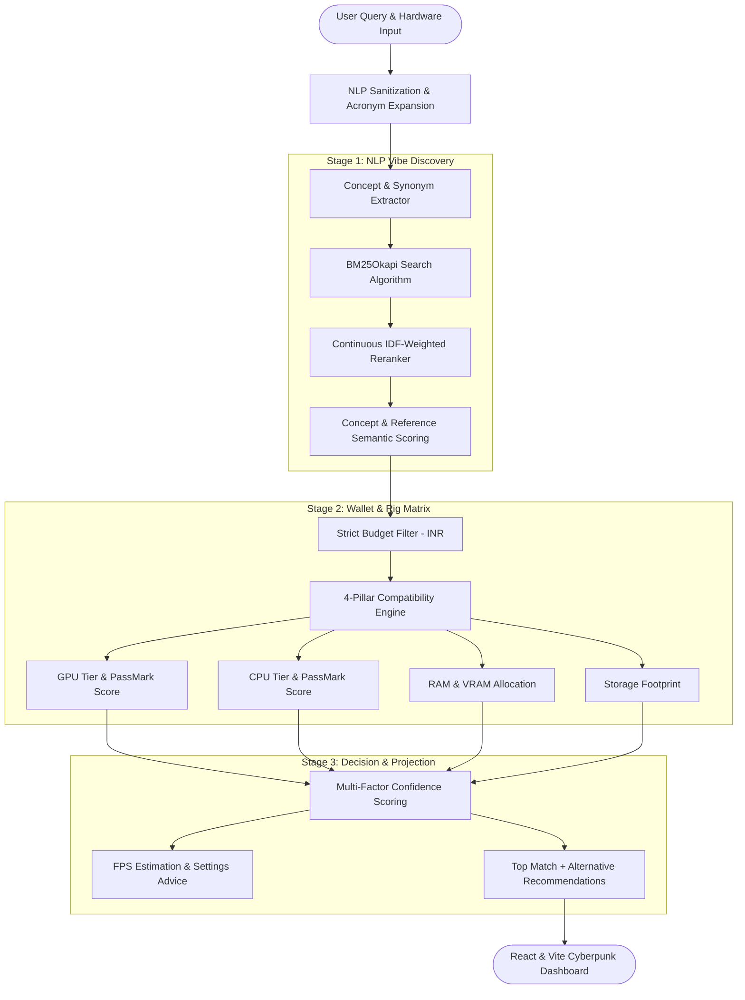

# 🎮 RigCheck

<p align="center">
  
</p>

<p align="center">
  <strong>Next-Gen AI & Hardware-Aware Video Game Recommendation Engine</strong><br>
  <em>Match your desired Vibe, your exact Wallet, and your PC Rig with mathematical precision.</em>
</p>

<p align="center">
  <a href="#-quick-start"></a>
  <a href="https://fastapi.tiangolo.com/"></a>
  <a href="https://react.dev/"></a>
  <a href="https://tailwindcss.com/"></a>
  <a href="https://www.python.org/"></a>
  <a href="https://www.mongodb.com/"></a>
  <a href="https://store.steampowered.com/"></a>
</p>

---

## ⚡ Overview

**RigCheck** eliminates the frustration of buying games that your PC can't run or searching through thousands of titles that don't match your mood. 

Unlike generic recommendation engines that rely on superficial genre tags, RigCheck is powered by a **Two-Stage Hybrid Engine**:
1. **Mathematical Natural Language Processing (NLP)**: Blazing-fast BM25 ranking, query concept extraction, gaming acronym expansion, and continuous IDF reranking.
2. **4-Pillar Hardware Compatibility Engine**: Deep component-level checks (GPU, CPU, RAM, and Storage) mapped to PassMark benchmark scores, calculating exact compatibility percentages, estimated FPS, and expected graphical presets.

> [!IMPORTANT]
> **"Math First, Vibe Second."**
> RigCheck calculates real hardware constraints, budget cutoffs, and bottleneck diagnostics mathematically with **sub-10ms** search latency and **~109ms** end-to-end response times—zero bloated cloud LLM dependencies required for recommendations.

---

## 🚀 Key Highlights & What's New

- 🎮 **1,000+ Verified Steam Database**: Curated catalog of 1,000 top PC games with verified system requirements, native INR pricing, high-res screenshots, tags, and HLS video trailers.
- 🧠 **Intelligent Query & Vibe Engine**:
  - **Gaming Acronym Expansion**: Resolves abbreviations like `RDR2`, `GTA 5`, `L4D2`, `CS2`, `TLOU`, and franchise nicknames automatically.
  - **Dynamic Concept Engine**: Maps abstract query themes (`stealth`, `naval`, `heist`, `deckbuilder`, `co-op with friends`) to deep game concept graphs.
  - **Hardware Phrase Sanitization**: Automatically strips colloquial rig phrases (*"potato pc"*, *"toaster"*, *"laptop"*) from search tokens so they don't corrupt the game semantics.
  - **Typo Auto-Correction**: Levenshtein/difflib-powered correction with protected gaming dictionary.
  - **Vagueness Detection**: Dynamically adjusts search candidate pools (from 50 to 150 candidates) based on whether user input is specific, moderate, or broad.
- 🖥️ **4-Pillar Hardware Compatibility Matrix**:
  - **GPU Engine**: 5-Tier classification (D / C / B / A / S) backed by PassMark G3D benchmark databases.
  - **CPU Engine**: Multi-generation Intel & AMD processor benchmark lookup and tiering.
  - **RAM & VRAM Engine**: Strict allocation checks against game requirements with headroom analysis.
  - **Storage Engine**: Capacity verification and disk requirement checks.
  - **Performance Projection**: Generates estimated FPS ranges (e.g. `60-75 FPS`) and recommended settings (`Low`, `Medium`, `High`, `Ultra`).
- 🔐 **Dual OAuth & Secure Auth**:
  - Full **Steam OpenID 2.0** login with Steam avatar/profile fetching.
  - **Google OAuth 2.0 / OpenID Connect** authentication.
  - Traditional Email/Password registration with **bcrypt** encryption.
  - Secure HTTP-only session cookie management backed by MongoDB Atlas.
- 🎨 **Cinematic Cyberpunk UI**:
  - Fullscreen video background layers with real-time crossfading based on hovered genre tiles.
  - Interactive Genre Discovery matrix (`Action`, `RPG`, `Strategy`, `Indie`, `Simulation`, `Adventure`).
  - Searchable, filterable game gallery with real-time query suggestions.
  - Comprehensive Game Detail modal featuring embedded Steam video player, screenshots gallery, and detailed specs breakdown.
  - Interactive RigCheck Diagnostic modal with live component health badges.

---

## 🏗️ System Architecture



---

## 📊 Hardware Tier System

RigCheck normalizes thousands of hardware configurations into an intuitive 5-tier classification backed by PassMark benchmarks:

| Tier | Letter | GPU Equivalent | CPU Equivalent | Target Gaming Experience |
|:---:|:---:|:---|:---|:---|
| **Tier 1** | **D** | Intel UHD / GT 710 / Vega 8 | Intel Core i3 (Older) / Athlon | Indie titles, Retro, 720p/30fps low |
| **Tier 2** | **C** | GTX 1050 / GTX 1650 / RX 560 | Intel Core i5 7th-9th Gen / Ryzen 3 | 1080p Esports, Older AAA (30-60 FPS) |
| **Tier 3** | **B** | GTX 1060 / RTX 3050 / RX 6500 XT | Intel Core i5 10th-11th Gen / Ryzen 5 3600 | 1080p High, Modern AAA (60 FPS) |
| **Tier 4** | **A** | RTX 3060 / RTX 4060 / RX 6700 XT | Intel Core i5 12th-13th Gen / Ryzen 5 5600X | 1080p Ultra / 1440p High (60-120 FPS) |
| **Tier 5** | **S** | RTX 3080 / RTX 4080 / RTX 4090 / RX 7900 | Intel Core i7/i9 13th-14th Gen / Ryzen 7/9 | 1440p / 4K Ultra, Maximum Ray Tracing |

---

## 🛠️ Tech Stack

### Frontend
- **Framework:** [React 18](https://react.dev/) + [Vite](https://vitejs.dev/)
- **Styling:** [Tailwind CSS](https://tailwindcss.com/)
- **Animation:** [Framer Motion](https://www.framer.com/motion/)
- **Media Player:** [HLS.js](https://github.com/video-dev/hls.js/) (Steam trailer video streaming)
- **Icons:** [Lucide React](https://lucide.dev/)

### Backend & API
- **Framework:** [FastAPI](https://fastapi.tiangolo.com/) (Asynchronous Python REST API)
- **Server:** [Uvicorn](https://www.uvicorn.org/)
- **Data Validation:** [Pydantic v2](https://docs.pydantic.dev/)
- **Authentication:** Steam OpenID 2.0, Google OAuth 2.0 / OpenID Connect, Bcrypt password hashing
- **Database Driver:** [Motor](https://motor.readthedocs.io/) & [PyMongo](https://pymongo.readthedocs.io/) (MongoDB Atlas)

### Machine Learning & Data Processing
- **Search Engine:** `rank_bm25` (BM25Okapi scoring)
- **NLP Toolkit:** `nltk` (PorterStemmer, English corpus tokenizer)
- **Data Manipulation:** `pandas`, `numpy`
- **String Matching:** `difflib` (Fuzzy keyword matching & correction)

---

## 📁 Repository Structure

```text
RigCheck/
├── app.py                      # FastAPI application, routing, and OAuth callbacks
├── auth.py                     # Authentication logic (Google OAuth, Steam OpenID, bcrypt)
├── db.py                       # MongoDB connection & index initialization
├── requirements.txt            # Python dependencies
├── package.json                # Frontend dependencies & Vite scripts
├── vite.config.js              # Vite bundler configuration & backend API proxy
├── run_local.bat               # One-click startup script (Backend + Frontend)
│
├── model/                      # Recommendation & Compatibility Engines
│   ├── rigcheck_engine.py      # Core NLP, query expansion, BM25, and reranking
│   ├── compatibility_engine.py # 4-pillar hardware evaluation & bottleneck logic
│   ├── concept_engine.py       # Concept extraction graph & vocabulary
│   ├── steam_database.py       # In-memory fast game lookup & dataset loader
│   ├── ram_tier_engine.py      # RAM evaluation & allocation requirements
│   └── storage_engine.py      # Storage footprint validator
│
├── gpu/                        # GPU Database & Tiering Engine
│   ├── gpu_tier_engine.py      # GPU model normalizer and tier resolver
│   ├── gpu_tiers.json          # Mapped GPU tiers
│   └── gpu_lookup.json         # PassMark benchmark scores lookup table
│
├── cpu/                        # CPU Database & Tiering Engine
│   ├── cpu_tier_engine.py      # CPU model normalizer and tier resolver
│   ├── cpu_tiers.json          # Mapped CPU tiers
│   └── cpu_lookup.json         # PassMark benchmark scores lookup table
│
├── data/                       # Dataset Storage
│   ├── games_database_final.json # 1,000 verified Steam titles with media & specs
│   ├── game_aliases.json       # Game acronyms and canonical title mapping
│   └── search_metadata.json    # Pre-computed game semantic concepts
│
├── src/                        # React Frontend Source
│   ├── App.jsx                 # Root UI controller & modal state
│   ├── LandingPage.jsx         # Auth landing page with particle background
│   ├── HeroSection.jsx         # Hero banner & primary CTAs
│   ├── GenreDiscovery.jsx      # Interactive genre grid with video hover
│   ├── GameGallery.jsx         # Filterable game catalog grid
│   ├── GameDetailModal.jsx     # Full modal view with Steam trailers & specs
│   ├── DiagnosticModal.jsx     # RigCheck AI diagnostic runner modal
│   ├── RigCheckDashboard.jsx   # Hardware input form & results dashboard
│   └── BackgroundVideoLayer.jsx# Crossfading cinematic video backdrop
│
└── public/                     # Static media & banner assets
```

---

## ⚡ Quick Start

### Prerequisites
- **Python 3.11+** installed ([Download Python](https://www.python.org/downloads/))
- **Node.js 18+** & `npm` installed ([Download Node.js](https://nodejs.org/))
- **MongoDB Atlas** database connection URI (or local MongoDB)

---

### Option 1: One-Click Startup (Windows)

Simply double-click or run:

```bat
run_local.bat
```

> This script will automatically create a Python virtual environment, install Python and npm packages, and launch both the **FastAPI Backend (Port 8000)** and **Vite Frontend (Port 5173)** in separate terminal windows!

---

### Option 2: Manual Installation

#### 1. Clone the repository
```bash
git clone https://github.com/Shreesh0300/RigCheck.git
cd RigCheck
```

#### 2. Configure Environment Variables
Copy `.env.example` to `.env` and fill in your credentials:
```bash
cp .env.example .env
```
Key configuration items:
```ini
MONGODB_URI="mongodb+srv://<username>:<password>@<cluster>.mongodb.net/"
MONGODB_DB_NAME=rigcheck_db
FRONTEND_URL=http://localhost:5173

# Optional: Google OAuth Credentials
GOOGLE_CLIENT_ID=
GOOGLE_CLIENT_SECRET=

# Optional: Steam API Key
STEAM_API_KEY=
```

#### 3. Setup Python Backend
```bash
# Create and activate virtual environment
python -m venv venv
venv\Scripts\activate   # On Windows
# source venv/bin/activate # On Linux/macOS

# Install dependencies
pip install -r requirements.txt

# Start FastAPI server
uvicorn app:app --reload --host 127.0.0.1 --port 8000
```

#### 4. Setup React Frontend
In a new terminal window:
```bash
# Install node dependencies
npm install

# Start Vite dev server
npm run dev
```

Visit **`http://localhost:5173`** in your browser!

---

## 📡 API Reference

| Endpoint | Method | Description |
|:---|:---:|:---|
| `/recommend` | `POST` | Core recommendation endpoint. Accepts vibe text, budget, GPU, CPU, RAM, and Storage. |
| `/games` | `GET` | Paginated catalog of Steam games (`limit`, `offset`). |
| `/games/{appid}` | `GET` | Complete metadata, screenshots, trailers, requirements, and pricing for a single game. |
| `/search` | `GET` | Fast title & concept search (`?q=<query>`). |
| `/stats` | `GET` | Database statistics (total games, reqs coverage, trailer count). |
| `/auth/status` | `GET` | Returns available authentication providers. |
| `/auth/register` | `POST` | Register a new user account with email and password. |
| `/auth/login` | `POST` | Authenticate existing user with email and password. |
| `/auth/google/login` | `GET` | Initiates Google OAuth 2.0 flow. |
| `/auth/steam/login` | `GET` | Initiates Steam OpenID 2.0 flow. |
| `/auth/me` | `GET` | Returns current user session info from cookie. |
| `/auth/logout` | `POST` | Terminates active session. |

### Sample Recommendation Request

```bash
curl -X POST "http://127.0.0.1:8000/recommend" \
     -H "Content-Type: application/json" \
     -d '{
       "description": "games like rdr2 with deep open world and horses",
       "budget": 2000,
       "gpu_name": "GTX 1650",
       "cpu_name": "Core i5-9400F",
       "ram": 16,
       "storage_gb": 150
     }'
```

---

## 📈 Performance & Evaluation

RigCheck is systematically evaluated using an automated benchmark suite (`evaluate_search.py`) across **94 distinct test cases** spanning acronyms, typos, vague queries, and multi-concept prompts:

| Metric | Benchmark Result |
|:---|:---:|
| **Average BM25 Latency** | `~9.06 ms` |
| **Average End-to-End Latency** | `~109.5 ms` |
| **P95 Latency** | `~199.1 ms` |
| **Total Query Test Cases** | `94 / 94 Passed` |
| **Verified Database Size** | `1,000 Games` |

---

## 👥 Contributors

- **Shreesh Kulkarni** ([@Shreesh0300](https://github.com/Shreesh0300))
- **Rohit Bastikar** ([@rohitbastikarraghavendra-maker](https://github.com/rohitbastikarraghavendra-maker))

---

<p align="center">
  <sub>Built with ❤️ for gamers who want the right game on the right rig at the right price.</sub>
</p>
